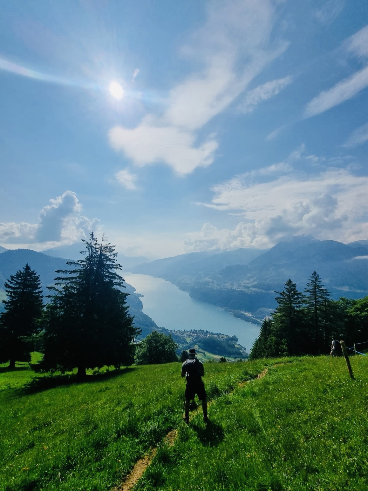

---
# the default layout is 'page'
icon: fas fa-info-circle
order: 4
---

Hi there,

I'm Tobi, a team lead at a Swiss bank, where I currently lead three DevOps teams in the securities trading division.

From 2024 to 2026 I studied part-time for an MSc in Enterprise IT Management at the University of Essex Online, finishing with a dissertation on [measuring technical debt in mission-critical trading systems](https://github.com/TobiZeier/MScProject/blob/main/MScProject/Measuring-Technical-Debt-in-Mission-Critical-Trading-Systems.pdf). I started this site as the e-Portfolio for the programme. It documents each module, my assignments and my reflections along the way. If you're new here, the [Start here]() post is the best overview.

- 🎓 **Degree:** MSc Enterprise IT Management, University of Essex Online, 2024–2026
- 📄 **Dissertation:** *Measuring Technical Debt in Mission-Critical Trading Systems* (70%)
- 🧰 **Focus:** IT service management, risk and decision modelling, data analysis
- 🗂 **Work samples:** [Projects]()

If you'd like to find out more about my professional life, I invite you to take a look at my [CV](/assets/misc/TobiasZeierCVen.pdf).

I enjoy doing sport in my free time. I regularly go to the gym, go hiking in the mountains in summer and skiing in winter. I like travelling the world and I'm currently focusing on East Asia.

{: w="450" h="600" }
_Me on a hike to [Mount Federispitz](https://en.wikipedia.org/wiki/Federispitz), St. Gallen, Switzerland_

I'm best reached through [LinkedIn](https://www.linkedin.com/in/tobias-zeier/). I'm always open to interesting conversations and collaboration.
